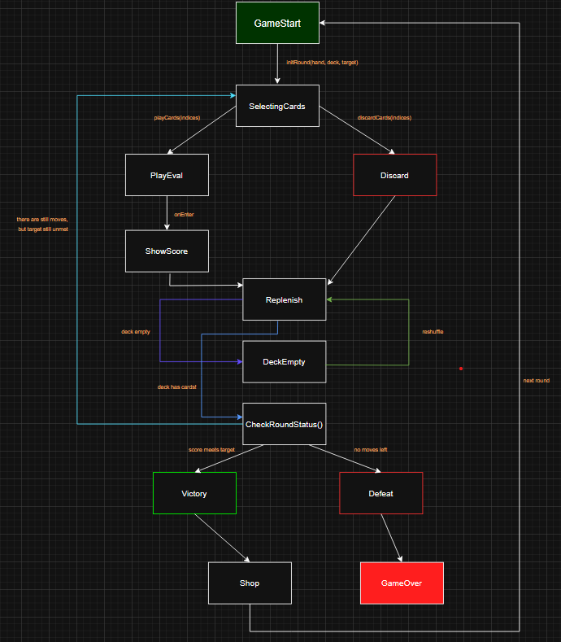

# Malatro : Scala

Project structure:

Elements
--------------------------------

score: Score trait (chips, multiplier, total)

rank:  Rank hierarchy - Ace to King, classified as Even, Odd, or Figure

suit:  Four standard suits

card:  TCard / ACard / Card - a playing card combining Rank and Suit

joker:  TJoker / AJoker and four concrete Jokers

hand:  TCardCollection / AHand / Hand - holds cards and jokers

combinations:  TCombination / ACombination and six poker combinations 

test: mirrors the src layout, one test suite per package

exceptions:  12 distinct exception classes extending the basic Scala exception class in order to be thrown
whenever their respective conditions are met. Divided into a basic category, along with discard and play for visual clarity. 

--new--

controller: main controller for a round of malatro. It manages the round state machine and reacts 
to notifications from hand, thus merging both State and Observer patterns in its instancing.

states: An ensemble of states that can be transitioned between, the point here was to envision 
what would happen outside the basic states. Which is why transition states were added in order to
make a more sensible chain of command.

deck: Because there had to be a way to replenish the deck (otherwise the game would make no sense), 
the logic of a deck was centralized here along with a discard pile.

observer:  An observer registers itself with a TSubject through a list construct and is notified whenever the subject's state changes.

scorecalculator: Construct in order to calc the final score for a played set of cards + active jokers.

A Score has a chip count and a multiplier. total is derived as chips × multiplier.

Visual Overview
-------------------------------------
src/main/scala
├── card/    

├── combinations/

├── controller/

├── deck/

├── exceptions/

├─────── discard/

├─────── play/

├── hand/         

├── joker/        

├── rank/

├──── classes/

├──── numbers/

├─────── even/

├─────── figure/

├─────── odd/

├── score/

├── scorecalculator/

├── states/

├── suit/

src/test/scala
├── applyscore/

├── card/

├── combinations/

├── controller/

├── deck/

├── exceptions/

├── hand/

├── joker/

├── observer/

├── rank/

├── score/

├── scorecalculator/

├── suit/

Overview
--------------------------------
Rank:

Thirteen ranks from Ace to King. Each rank has

- an order (1–13) and a value (scoring value)
- a RankClass: EvenClass, OddClass, or FigureClass (J, Q, K)
- Ace is Odd. Its order is 1 but its value is 11.

Suit:

Four suits: 
- Hearts
- Spades
- Clover
- Diamonds.

Card:

A Card takes a Rank and a Suit. Its name is derived as "<Rank> of <Suit>". 
Cards are ordered and comparable by name.

Joker: 

Four jokers, each with a name and a description of its effect:

- Greedy Joker: diamond suit played cards each give +3 multiplier
- Devious Joker:  +100 chips if hand contains a Straight
- Even Steven: played even-ranked cards each give +4 chips
- Scary Face: played face cards each give +30 chips

Hand:

A Hand holds a collection of Cards and Jokers. 
Cards and jokers are placed individually and retrieved by index or as a full list.

Combinations:

Six poker combinations evaluated in priority order.

Combinations (priority order)

│ Priority        │ Chips │ Multiplier   │ Requirement                          │

│ 1. StraightFlush│  100  │     ×8       │ 5 consecutive cards, same suit       │
│ 2. Flush        │   35  │     ×4       │ 5 cards, same suit, any order        │
│ 3. Straight     │   30  │     ×4       │ 5 consecutive cards, any suit        │
│ 4. ThreeOfAKind │   30  │     ×3       │ 3+ cards sharing the same rank       │
│ 5. Pair         │   10  │     ×2       │ 2+ cards sharing the same rank       │
│ 6. HighCard     │    5  │     ×1       │ Any non-empty hand (fallback)        │

Exceptions and proc conditions

- HandFullException:          hand holds > 8 cards
- JokerLimitException:        hand holds > 2 jokers
- InvalidCidxException:       removeCard called with bad index
- InvalidJidxException:       removeJoker called with bad index
- CardMinPlayedException:     playCards called with < 1 index
- CardMaxPlayedException:     playCards called with > 5 indices
- CardInvalidListidxPlayedException:  any play index out of range
- CardMaxSetPlayedException:  playCards called > 3 times
- CardMinDiscardException:    discardCards called with < 1 index
- CardMaxDiscardException:    discardCards called with > 5 indices
- CardInvalidListidxDiscardException: any discard index out of range
· CardMaxTimesDiscardException: discardCards called > 3 times

Method changes 

1. Discard method in order for things to work properly
2. ApplyScore implementation through double dispatch:

A full double dispatch system was implemented across three axes: 
combination × joker, suit × joker, and rank class × joker. 
At the card level, applyScore ties all of these axes together.
For each active joker it first dispatches through the suit, then through the rank class, 
then unconditionally adds the rank's scoring value as chips.

3. Score is now a proper class as asked for in previous feedback
4. Every number now applies "extend" parameter fields rather than having them be part of their body as asked for in previous feedback as well
5. Necessary methods have been privatized as well, though it might still need some work, who knows.
6. Tests in /test/hand were divided into 4 types since the code got a little too long after documenting. 
   Though perhaps, it might even be better to do that across the board. Will consider it for t3 because I'm finishing this a bit late already...

7. Added a controller to manage states along with a plugged in Observer design pattern. 
8. The states have a particular transition graph, which will be included as both an image and as a
   text graph for legibility. 

## State Diagram

